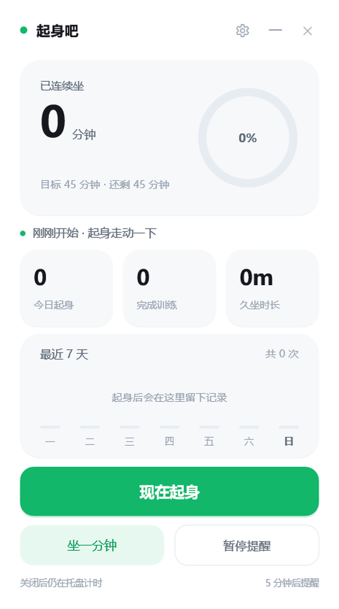
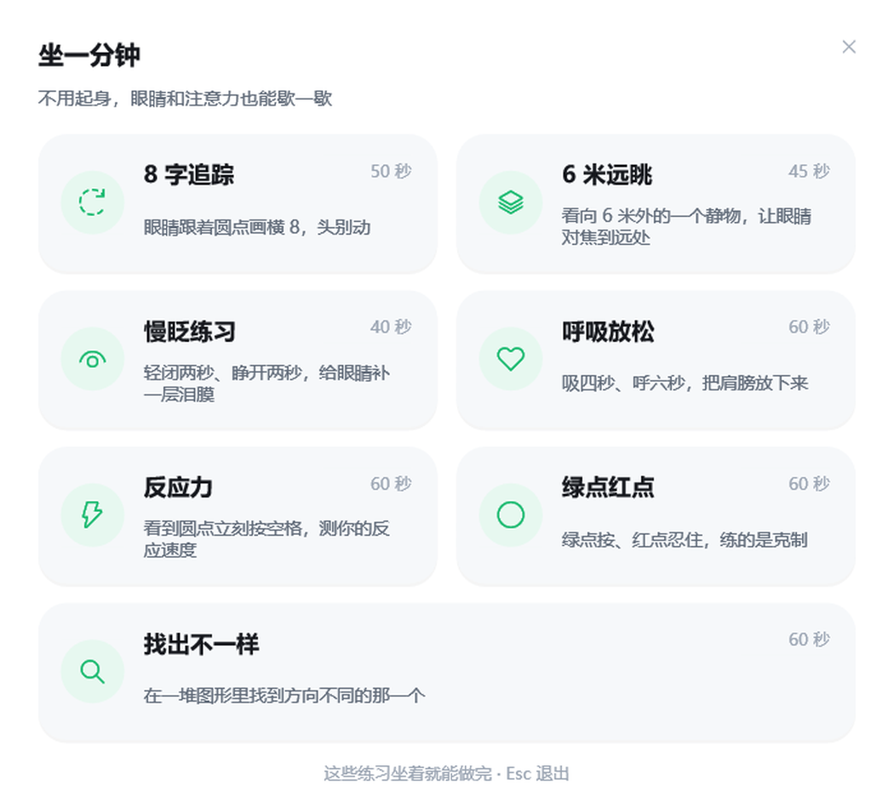
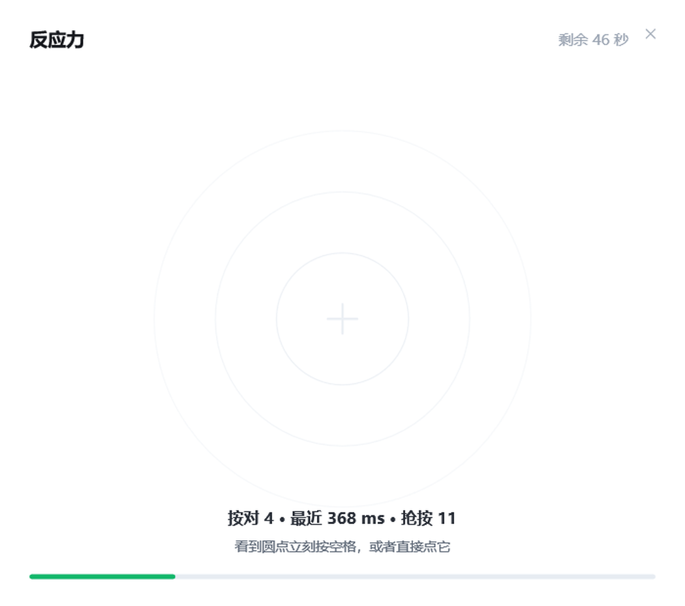
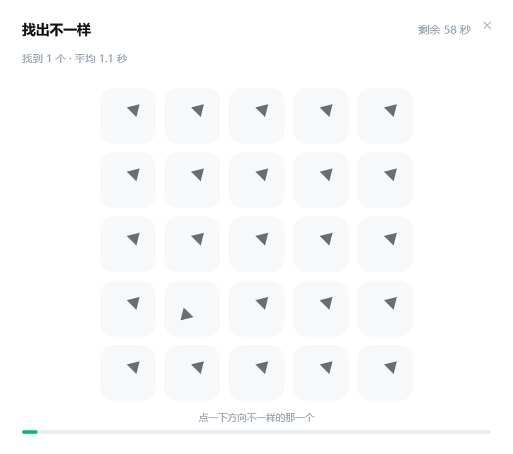
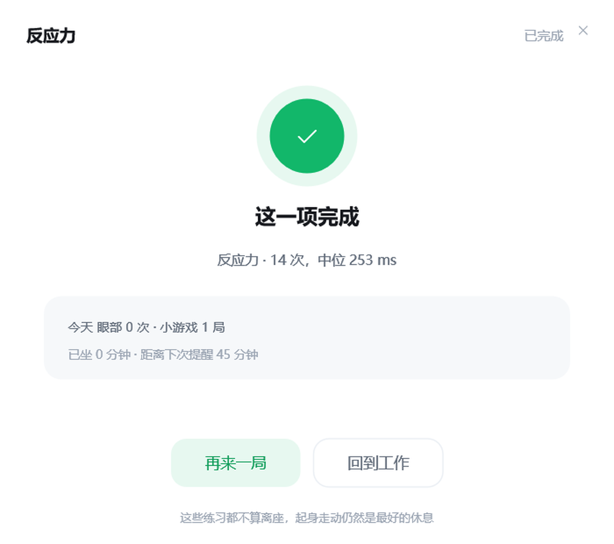
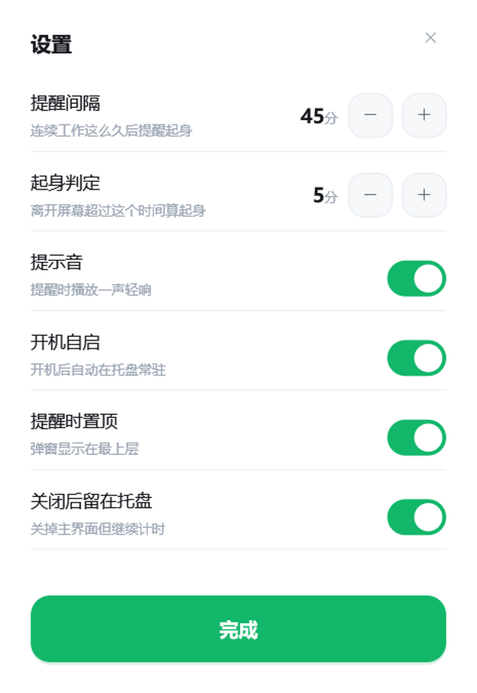

# 起身吧 · SitBreak

> 久坐提醒 + 微训练，一个 925 KB 的原生 Windows 小工具。不安装运行时，不联网，不读你的键盘。


到点提醒你站起来，顺手带一套 30 秒就能做完的拉伸；不想起身的时候，还有一组**坐着就能做完**的眼睛与注意力小练习。

界面用 Direct2D + DirectWrite 直接绘制，125% / 150% 缩放比例下依然是矢量锐利；动画是真实的弹簧物理（欠阻尼），不是补间。



---

## 特性

**提醒**

- 默认每 45 分钟提醒一次（15–120 分钟可调）。
- 开机自启，登录就在托盘里计时；退出再打开，今天的累计接着算，每天零点自动翻篇。
- 离开座位超过 5 分钟（可调）自动记一次「起身」并清零计时 —— 不会因为你刚上过厕所又提醒你。
- 提醒卡上直接三选一：**开始拉伸** / **坐一分钟** / **稍后**。
- 走系统通知通道（通知中心可见），遵守「专注助手 / 勿扰」。

**起身微训练**：12 套动作，30–120 秒，分步计时引导，可暂停可跳过。

| 部位 | 动作 |
|---|---|
| 脖子 | 颈部侧向拉伸 |
| 肩背 | 肩部绕环、扩胸开肩、靠墙天使 |
| 腰胯 | 髂腰肌拉伸、体侧伸展、臀桥 |
| 腿脚 | 靠墙静蹲、提踵、深蹲 |
| 手腕 | 手腕放松 |
| 眼睛 | 20-20-20 远眺 |


**坐一分钟**：不用起身，坐着就能做完。



| 项目 | 时长 | 做什么 |
|---|---|---|
| 8 字追踪 | 50s | 眼睛跟着圆点画横 8，头不动（低速平滑追随，约 22°/s） |
| 6 米远眺 | 45s | 看向 6 米外一个静物，让睫状肌松开 |
| 慢眨练习 | 40s | 闭两秒、睁两秒 —— 用屏时眨眼率会掉到 5–7 次/分（正常约 15） |
| 呼吸放松 | 60s | 吸 4 秒、呼 6 秒，延长呼气 |
| 反应力 | 60s | 亮点亮起立刻按空格 / 点它，记个人中位反应时 |
| 绿点红点 | 60s | 绿点按、红点忍住，练抑制控制 |
| 找出不一样 | 60s | 25 格里找出方向不同的那一格 |




每局结束停在成绩页：这一局的成绩、今天累计、距离下次提醒还剩多久，可以「再来一局」或「回到工作」。



> 这些练习只做「放松 / 中断持续注视 / 换一换注意力」，不宣称矫正视力或治疗任何疾病。
> 眼睛有不适，或本身有青光眼、视网膜病变、眼科手术史，请先问医生。

**看懂自己的节奏**：首页显示今天连续坐了多久、还剩多久提醒、今日起身次数与久坐总时长，外加 7 天柱状图。



---

## 为什么是原生 C++

| | |
|---|---|
| 渲染 | Direct2D + DirectWrite，按 DPI 缩放真实排版，不靠位图放大 |
| 动画 | 欠阻尼弹簧 `k=200 c=26`（按下 `k=460`、勾选 `k=250`），过冲才有的「果冻」手感 |
| 功耗 | 事件驱动：没有动画时 `KillTimer`，只留 1 秒的计时器。实测空闲 15 秒耗 CPU 0.03–0.06s（≈0.3% 单核），工作集 40 MB |
| 依赖 | 只用系统 DLL（`d2d1` / `dwrite` / `dwmapi` / `shell32`），静态链接，单文件 exe |
| 隐私 | 不联网、不上传、不读键盘内容，只用 `GetLastInputInfo` 判断空闲 |

---

## 使用

1. 双击 `SitBreak.exe`（或桌面快捷方式「起身吧 SitBreak」）。
2. 主界面：「现在起身」立刻开始一次拉伸；「坐一分钟」打开坐着做的练习；「暂停提醒」临时停表。
3. 右下角「5 分钟后提醒」= 手动推迟下一次提醒。
4. 右上角 `×` 默认「留在托盘继续计时」；要彻底退出用托盘右键 → 退出。

**任务栏**：主界面有任务栏按钮，最小化后点任务栏图标即可弹回；重复双击 exe 只会把已有窗口叫到前面，不会开第二个进程。

**托盘右键菜单**：显示主界面 / 现在起身 / 暂停提醒 / 设置 / 退出。悬停图标可看到实时状态，例如「已坐 12 分钟 · 33 分钟后提醒」。

**训练里的操作**：空格或点击 = 反应；`Esc` = 退出当前练习。

---

## 设置

| 项 | 说明 |
|---|---|
| 提醒间隔 | 连续工作多久后提醒（15–120 分钟） |
| 起身判定 | 离开多久算一次起身（2–20 分钟） |
| 提示音 | 提醒时是否播放一声轻响 |
| 开机自启 | 写 `HKCU\Software\Microsoft\Windows\CurrentVersion\Run`，登录后托盘静默启动 |
| 提醒时置顶 | 提醒卡是否压在其他窗口之上（默认开，防止被全屏播放器挡住） |
| 关闭后留在托盘 | `×` 是退出还是缩到托盘 |

---

## 数据与隐私

- 全部数据在 `%APPDATA%\SitBreak\`：`config.ini`（设置 + 当前累计）、`stats.ini`（每日统计，保留最近 45 天）。
- 删掉这个文件夹即完全清空记录。
- 程序不发起任何网络请求，也不读取键盘输入内容。

---

## 从源码构建

需要任意支持 C++17 的 MinGW-w64 g++（要带 `d2d1.h` / `dwrite.h` / `dwmapi.h`）：

```bat
git clone https://github.com/<you>/sitbreak.git
cd sitbreak
set MINGW_BIN=C:\msys64\mingw64\bin
build.bat
```

输出 `build\SitBreak.exe`。没有现成工具链的话，装 [MSYS2](https://www.msys2.org/) 后执行
`pacman -S mingw-w64-x86_64-gcc`，或者直接用 [winlibs](https://winlibs.com/) 的绿色版解压即用。

也可以手写一行命令：

```bat
g++ -std=c++17 -O2 -municode -mwindows -static -static-libgcc -static-libstdc++ ^
    -o build\SitBreak.exe src\main.cpp src\app.cpp ^
    -ld2d1 -ldwrite -ldwmapi -lshell32 -lole32 -luser32 -lgdi32 -luuid -lshlwapi -lwinmm
```

### 命令行参数

| 参数 | 作用 |
|---|---|
| `--silent` | 只驻留托盘，不显示主界面（开机自启用的就是这个） |
| `--autostart=on\|off` | 写入 / 移除开机自启项后退出 |
| `--demo=prompt` | 预览提醒卡 |
| `--demo=pick` | 预览「坐一分钟」列表 |
| `--demo=train` / `--demo=done` | 预览训练中 / 训练完成态 |
| `--demo=eye\|far\|blink\|breathe\|react\|gonogo\|search` | 预览某个坐着练的项目 |
| `--demo=playdone` | 预览成绩页 |
| `--demo=settings` / `--demo=toast` | 预览设置页 / 气泡 |

---

## 目录结构

```
.
├── build.bat               # 一键构建
├── src/
│   ├── common.h            # 主题、弹簧、数据结构、App 声明
│   ├── app.cpp             # 计时状态机、配置、统计、托盘、通知、自启
│   └── main.cpp            # Direct2D 渲染、各窗口与交互
├── tools/
│   ├── shot.py             # 按窗口标题截图（PrintWindow 直抓 D2D 画面）
│   ├── click.py            # 按 DIP 坐标点按钮，做自动点击验证
│   └── tray_test.py        # 弹出托盘菜单并截图
├── docs/                   # README 用截图
└── .github/workflows/      # CI：MinGW 构建 + 产物归档
```

`tools/` 里的脚本是开发期验证工具（Python 3 + Pillow，仅截图需要），`shot.py` 对 Direct2D 窗口用
`PrintWindow(PW_RENDERFULLCONTENT)`，比屏幕抓取可靠 —— 即使窗口被别的窗口挡住也能拿到真实画面。

---

## 常见问题

**没收到通知？** 检查 Windows「设置 → 系统 → 通知」里没有关掉本程序，并且没开「专注助手 / 勿扰」。

**提醒卡被挡住了？** 设置里打开「提醒时置顶」。

**想更频繁提醒？** 间隔调到 15–30 分钟；「起身判定」别调太小，否则短暂走开也会被记成起身。

**点了任务栏图标没反应？** 当前版本已修（原因：`WS_POPUP` 缺 `WS_MINIMIZEBOX|WS_SYSMENU`，且 `SC_RESTORE` 被自己的 `WM_SYSCOMMAND` 吞掉，绕过了系统的前台激活）。若仍遇到，先看托盘里是不是只有一个图标。

---

## 贡献

Issue / PR 都欢迎。改界面时可以用 `--demo=xxx` 直接预览某个界面，不用等 45 分钟。
提交前请确认 `build.bat` 能过，以及 `tools/shot.py` 截出来的界面没有错位。

## 许可

[MIT](LICENSE)

---

## English

**SitBreak** is a tiny (925 KB) native Windows tray app that reminds you to stand up, then guides you through a 30-second mobility break — or a one-minute seated eye / attention drill when you cannot leave your desk.

- Direct2D + DirectWrite UI, spring-based motion, crisp at 125% / 150% scaling
- No runtime dependencies, no network access, no keystroke logging (idle detection via `GetLastInputInfo`)
- ~0.3% of one core when idle, 40 MB working set
- 12 standing micro-exercises and 7 seated drills (eye tracking, palming-style blinks, 20-20-20, reaction time, go/no-go, visual search)
- Build with any MinGW-w64 g++ ≥ C++17: `set MINGW_BIN=...` then `build.bat`

The drills are for relaxation and breaking up sustained near-focus only. They are not a treatment for myopia or dry eye — talk to an eye-care professional if you have symptoms.
